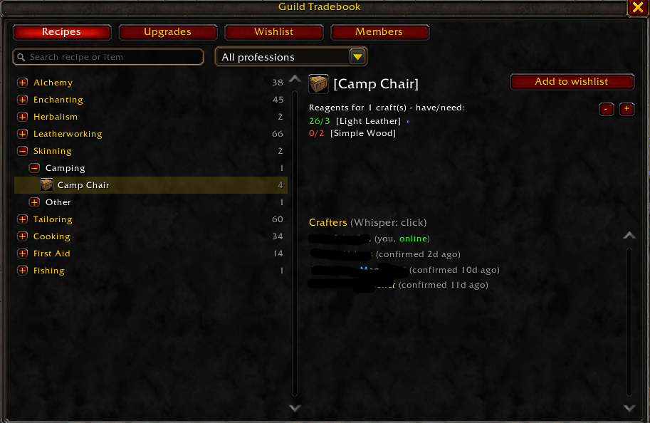
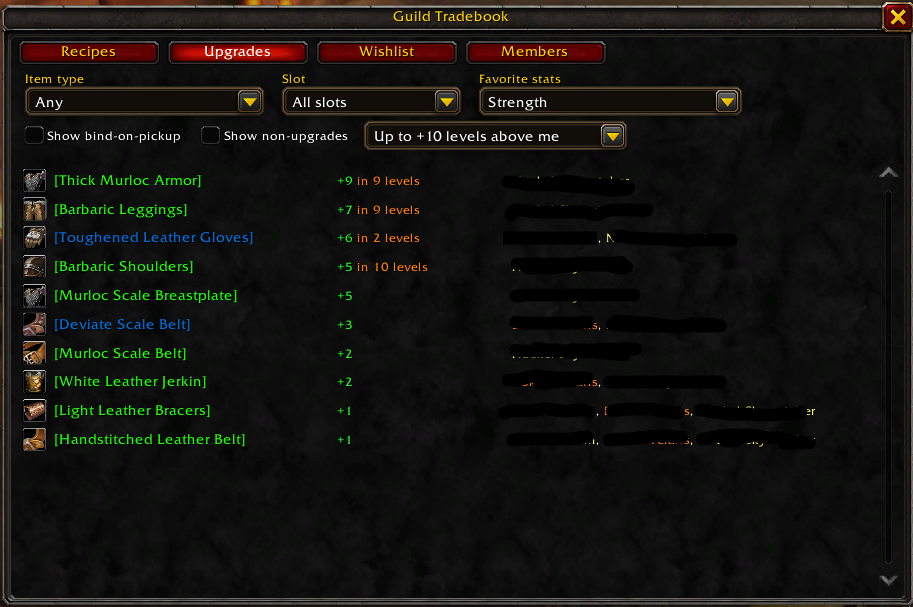
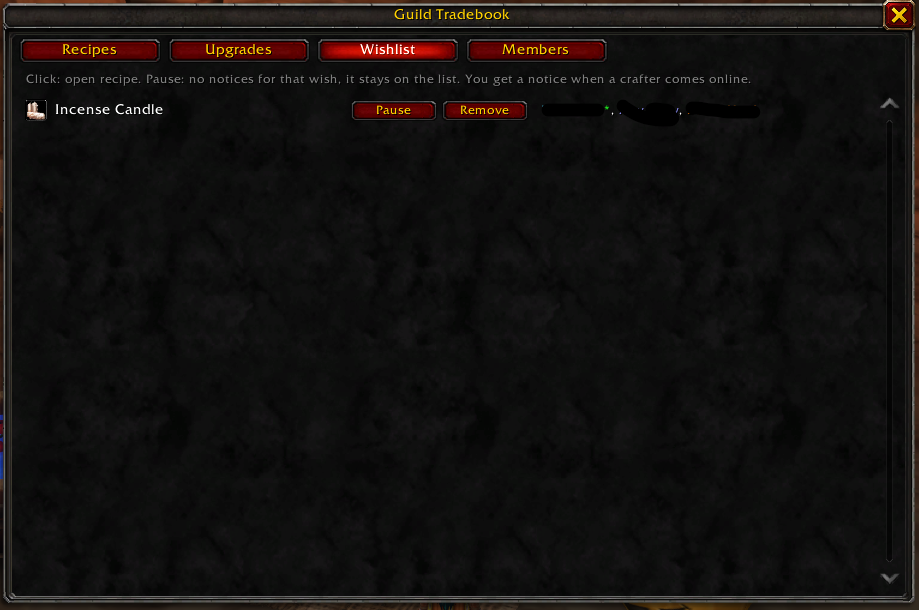
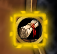
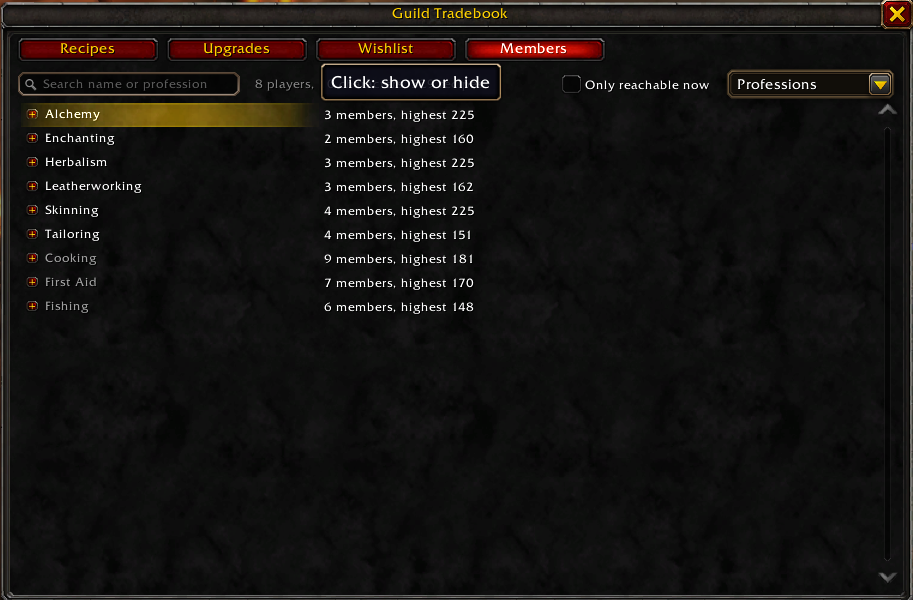
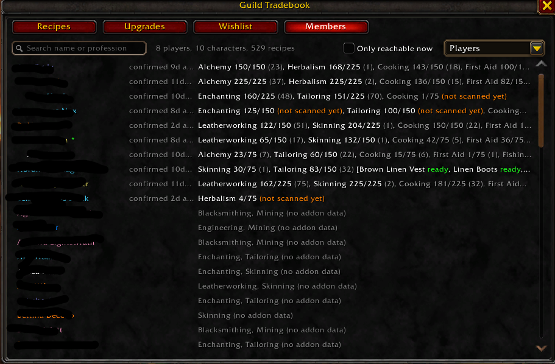
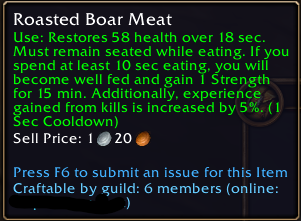
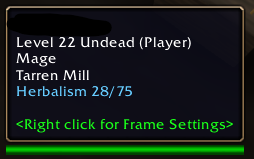

# CurseForge project texts (copy and paste)

Not part of the addon zip. Update the file list and the changelog with every upload.

## Project

| Field | Value |
|---|---|
| Game / type | World of Warcraft / Addons |
| Name | Guild Tradebook |
| Author | albertlast |
| Project ID | 1752487 (`## X-Curse-Project-ID` in the TOC) |
| Categories | Professions, Guild, Tooltip (whatever the form offers that fits) |
| Source / issues | https://github.com/albertlast/WoWFGRezept (public) |
| License | your choice; the form requires one ("All Rights Reserved" is allowed) |

### Summary (max. 250 characters)

Guild recipe sharing: every member who runs the addon shares their recipes, so you can search what anyone in the guild can craft, even offline. Gear upgrade finder, wishlist, !craft in guild chat. English and German.

### Description (Markdown)

```markdown
# Guild Tradebook

**Who in the guild can craft this?** Every guild member who runs Guild Tradebook shares their professions and recipes with the guild automatically, and members pass on the recipes of others. You can search everything the guild can craft, **even when the crafter is offline**.

Built for **World of Warcraft: Forever** (interface 16001). Available in English and German.

## Recipes

Every recipe the guild can craft, grouped like the profession window (profession > category). Search by recipe or item name, or filter by profession. Select a recipe to see who can craft it (online first, click to whisper) and the reagents with how many you have against how many you need. At a mailbox, **right-click a crafter to mail them the reagents**: the addon splits the stacks and fills in the mail, you click Send.



## Upgrades

Pick an item type, a slot and the stats you care about. The addon lists craftable items by guild members that beat what you wear, with the stat gain and how many levels you still need. You can give every stat its own weight in the settings.



## Wishlist

Mark the recipes you want. When a guild member who can craft one comes online, you get a chat notice and the minimap button starts to glow. Pause single wishes if you do not want to be bothered.





## Members

See who shares what and how fresh it is. The **Professions** view shows who is close to the skill cap and which profession your guild still lacks; the **Players** view lists every player with their characters, skill levels, specializations (Dragonscale Leatherworking, Gnomish Engineering, ...) and crafting cooldowns (you can choose not to share yours). Cooldowns are kept up to date without opening the profession window, the Salt Shaker included. Alts are grouped under one player, and members without the addon show up with the professions the server reports.





## Tooltips

"Craftable by guild: ..." on items (not on bind-on-pickup ones, nobody could hand them over), "Known in your guild by ..." on recipes, and the professions of a guild member when you hover them. A **tooltip filter** in the settings hides basics everyone makes (First Aid and Fishing are off by default).





## More

- **`!craft <item>` in guild chat:** the addon answers by whisper for members without the addon (can be turned off).
- **Export** of the guild data as JSON for Discord bots or spreadsheets (`/gtb export`).

## Getting started

1. Everybody in the guild installs the addon.
2. **Open each of your professions once** and click each profession tab: that is the only time the game exposes your recipe list. The addon scans and shares it. New recipes and skill-ups follow automatically.
3. Open the window with `/gtb` (or the minimap button).

## Good to know

- It only talks to guild members through addon messages; nothing leaves the game. What is shared: your characters' professions, recipes, skill levels and (optionally) cooldowns.
- A new member syncs with one online guildmate at login, not with everyone, so a big guild does not flood the chat.
- Rogue Poisons are not shared (a class skill, everyone makes their own).
- Settings: Options > AddOns > Guild Tradebook (sub-pages: stat weights, tooltip filter). `/gtb` shows all commands.

Source code and issues: https://github.com/albertlast/WoWFGRezept

Questions or bugs? Use the comments, the GitHub issues or message the author.
```

## File upload (0.9.0)

Done by the release workflow (tag `v0.9.0`); for a manual upload:

- File: `dist/GuildTradebook-0.9.0.zip` (one root folder `GuildTradebook`, matching `GuildTradebook.toc`)
- Release type: Release
- Display name: `0.9.0`
- Game version: World of Warcraft: Forever; the TOC says `## Interface: 16001`

### Changelog (Markdown)

```markdown
## 0.9.0

- Fix: recipe items (patterns, plans, ...) no longer claim "Not known in your guild yet" when someone does know the recipe.
- Members tab: click the line of a profession not read yet to open and read it.
- Members tab: transmutes share one cooldown and are one row now.
- Safer handling of values the game hides from addons.

## 0.8.0

- Fix: a profession without a learned recipe (Fishing at skill 1) no longer stays "not scanned yet" after you open its window; it shows 0 recipes.

## 0.7.0

- Fix for the Forever launch: the Lua error "bad argument #1 to 'ipairs' (table expected, got secret)" in Roster.lua on every guild roster update. It stopped the guild sync from starting. **Please update.**

## 0.6.0

- **Reagents by mail:** at a mailbox, right-click a crafter and choose "Mail reagents": the addon splits the stacks and fills in the mail, you click Send. Nothing is attached if a reagent is missing; chat names it.
- **Specializations** (Dragonscale Leatherworking, Weaponsmith, Gnomish Engineering, ...) in the Members tab and on player tooltips.
- **Cooldowns** stay current without opening the profession window; the **Salt Shaker** is shared too.
- No "Craftable by guild" line for bind-on-pickup items.
- Right-click menus: Whisper, Invite to party, Mail reagents.
- For other addons: `GuildTradebook_BuildExport()` returns the export JSON.
```

## Deutsch

Für die Gilde und deutschsprachige Besucher; die Beschreibung kann unter den englischen Text gesetzt werden.

### Zusammenfassung (max. 250 Zeichen)

Gildenrezepte automatisch teilen: Such nach, was jeder in der Gilde herstellen kann, auch wenn er offline ist. Mit Upgrade-Finder, Wunschliste und !craft im Gildenchat. Auf Englisch und Deutsch.

### Beschreibung (Markdown)

```markdown
# Guild Tradebook

**Wer in der Gilde kann das herstellen?** Jedes Gildenmitglied mit Guild Tradebook teilt seine Berufe und Rezepte automatisch mit der Gilde, und die Mitglieder geben die Rezepte der anderen weiter. So kannst du alles durchsuchen, was die Gilde herstellen kann, **auch wenn der Hersteller offline ist**.

Gebaut für **World of Warcraft: Forever** (Interface 16001). Auf Englisch und Deutsch.

## Rezepte

Alle Rezepte, die die Gilde herstellen kann, gruppiert wie im Berufsfenster (Beruf > Kategorie). Suche nach Rezept- oder Gegenstandsnamen oder filtere nach Beruf. Ein Klick auf ein Rezept zeigt, wer es herstellt (online zuerst, Klick zum Anflüstern) und die Materialien mit dem, was du hast, und dem, was du brauchst. Am Briefkasten **schickt ein Rechtsklick auf einen Hersteller ihm die Materialien per Post**: Das Addon teilt die Stapel und füllt den Brief aus, du klickst auf Senden.


## Verbesserungen

Wähle Gegenstandsart, Platz und die Werte, die dir wichtig sind. Das Addon listet herstellbare Gegenstände von Gildenmitgliedern, die besser sind als dein angelegter, mit dem Wertegewinn und den Stufen, die dir noch fehlen. In den Einstellungen bekommt jeder Wert sein eigenes Gewicht.


## Wunschliste

Markiere die Rezepte, die du haben willst. Sobald ein Gildenmitglied online kommt, das eines herstellen kann, bekommst du einen Chat-Hinweis und der Minimap-Knopf beginnt zu leuchten. Einzelne Wünsche lassen sich pausieren.


## Mitglieder

Wer teilt was, und wie aktuell sind die Daten? Die Ansicht **Berufe** zeigt, wer kurz vor der Maximalstufe steht und welcher Beruf in der Gilde noch fehlt; die Ansicht **Spieler** listet jeden Spieler mit seinen Charakteren, Skillstufen, Spezialisierungen (etwa in Lederverarbeitung, Schmiedekunst oder Ingenieurskunst) und Abklingzeiten (deine eigenen kannst du für dich behalten). Die Abklingzeiten bleiben aktuell, ohne dass du das Berufsfenster öffnest, auch die des Salzstreuers. Twinks sind unter einem Spieler zusammengefasst, und Mitglieder ohne das Addon erscheinen mit den Berufen, die der Server meldet.


## Tooltips

„Herstellbar in der Gilde: …“ bei Gegenständen (nicht bei beim Aufheben gebundenen, die könnte niemand weitergeben), „In deiner Gilde bekannt bei …“ bei Rezepten und die Berufe eines Gildenmitglieds, wenn du die Maus darauf hältst. Ein **Tooltip-Filter** in den Einstellungen blendet Alltägliches aus, das jeder kann (Erste Hilfe und Angeln sind standardmäßig aus).


## Mehr

- **`!craft <Gegenstand>` im Gildenchat:** Das Addon antwortet per Flüstern für Mitglieder ohne das Addon (abschaltbar).
- **Export** der Gildendaten als JSON für Discord-Bots oder Tabellen (`/gtb export`).

## Erste Schritte

1. Alle in der Gilde installieren das Addon.
2. **Öffne jeden deiner Berufe einmal** und klicke jeden Berufsreiter an: Nur dann gibt das Spiel deine Rezeptliste frei. Das Addon liest sie und teilt sie. Neue Rezepte und Skill-ups folgen automatisch.
3. Das Fenster öffnest du mit `/gtb` (oder dem Minimap-Knopf).

## Gut zu wissen

- Das Addon spricht nur über Addon-Nachrichten mit Gildenmitgliedern; nichts verlässt das Spiel. Geteilt werden Berufe, Rezepte, Skillstufen und (optional) Abklingzeiten deiner Charaktere.
- Ein neues Mitglied gleicht sich beim Login mit einem Online-Gildenmitglied ab, nicht mit allen. Auch eine große Gilde wird nicht zugespammt.
- Schurken-Gifte werden nicht geteilt (Klassenfertigkeit, jeder macht seine eigenen).
- Einstellungen: Optionen > AddOns > Guild Tradebook (Unterseiten: Wertegewichtung, Tooltip-Filter). `/gtb` zeigt alle Befehle.

Quellcode und Fehlermeldungen: https://github.com/albertlast/WoWFGRezept

Fragen oder Fehler? Schreib einen Kommentar, ein GitHub-Issue oder melde dich beim Autor.
```

### Changelog (Markdown)

```markdown
## 0.9.0

- Korrektur: Rezeptgegenstände (Muster, Pläne, ...) behaupten nicht mehr „In deiner Gilde noch unbekannt“, wenn jemand das Rezept kennt.
- Reiter Mitglieder: Ein Klick auf die Zeile eines noch nicht eingelesenen Berufs öffnet und liest ihn.
- Reiter Mitglieder: Transmutationen teilen sich eine Abklingzeit und sind jetzt eine Zeile.
- Sicherer Umgang mit Werten, die das Spiel vor Addons verbirgt.

## 0.8.0

- Korrektur: Ein Beruf ohne erlerntes Rezept (Angeln auf Stufe 1) bleibt nach dem Öffnen seines Fensters nicht mehr „noch nicht eingelesen“; er zeigt 0 Rezepte.

## 0.7.0

- Korrektur zum Forever-Start: Lua-Fehler „bad argument #1 to 'ipairs' (table expected, got secret)“ in Roster.lua bei jeder Aktualisierung der Gildenliste. Dadurch startete der Abgleich mit der Gilde nicht. **Bitte aktualisieren.**

## 0.6.0

- **Materialien per Post:** Am Briefkasten Rechtsklick auf einen Hersteller, „Reagenzien per Post“: Das Addon teilt die Stapel und füllt den Brief aus, du klickst auf Senden. Fehlt ein Material, wird nichts angehängt, und der Chat nennt es.
- **Spezialisierungen** (etwa in Lederverarbeitung, Schmiedekunst oder Ingenieurskunst) im Reiter Mitglieder und im Spieler-Tooltip.
- **Abklingzeiten** bleiben aktuell, ohne dass du das Berufsfenster öffnest; auch der **Salzstreuer** wird geteilt.
- Keine Zeile „Herstellbar in der Gilde“ mehr bei beim Aufheben gebundenen Gegenständen.
- Rechtsklick-Menüs: Flüstern, In Gruppe einladen, Reagenzien per Post.
- Für andere Addons: `GuildTradebook_BuildExport()` liefert das Export-JSON.
```

### Bildunterschriften für Screenshots

Die Bilder liegen in `docs/screenshots/` und sind in der Beschreibung über `raw.githubusercontent.com` eingebunden (erst nach dem Push auf `main`). Für die Galerie des Projekts (Reiter Images) werden dieselben Dateien hochgeladen.

| Datei | Deutsch | English |
|---|---|---|
| `recipes.png` | Alle Gildenrezepte, gruppiert wie im Berufsfenster, mit Herstellern und Materialien | Every guild recipe, grouped like the profession window, with crafters and reagents |
| `upgrades.png` | Herstellbare Verbesserungen für dich, mit den Stufen bis zur Nutzbarkeit | Craftable upgrades for you, with the levels until usable |
| `wishlist.png` | Wunschliste mit Pause und Entfernen | Wishlist with Pause and Remove |
| `minimap-glow.png` | Der Minimap-Knopf leuchtet, wenn ein Hersteller online kommt | The minimap button glows when a crafter comes online |
| `members-professions.png` | Berufe der Gilde mit Mitgliederzahl und höchster Stufe | Guild professions with member count and highest skill |
| `members-players.png` | Spieler mit Charakteren, Berufen und Alter der Daten | Players with characters, professions and age of the data |
| `item-tooltip-craftable.png` | „Herstellbar in der Gilde“ direkt im Item-Tooltip | "Craftable by guild" right in the item tooltip |
| `tooltip-player-professions.png` | Berufe im Spieler-Tooltip | Professions in the player tooltip |
